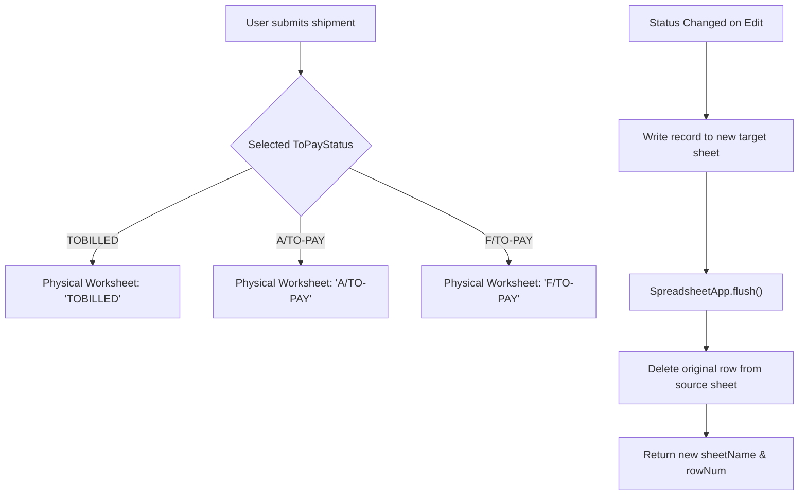

# 🚛 SR Brokerage Ledger — Upgrade 1.2 (PR #2)
### Fleet Logistics & Financial Accounts Management

A production-grade, high-performance enterprise web application designed for freight brokerage accounts, broker advances reconciliation, multi-point delivery tracking, Proof of Delivery (POD) monitoring, genuine multi-sheet Excel reporting, and three-physical-worksheet Google Sheets routing. Developed by **Shravan Kumar** for **Transport Brokerage Ledger Pvt Ltd**.

* **Mandatory Project Scope:** `E:\TR\P1\` (All development, UI, and backend code resides strictly in `P1`)
* **Reference System (Read-Only):** `E:\TR\SR_T`
* **Authoritative Cloud Backend:** `E:\TR\P1\backend\Code.gs` (Google Apps Script Web App)
* **Active Deployment Endpoint (Version 5):** `https://script.google.com/macros/s/AKfycbwqykkt53iglV7FrceyixlDjUSe5ry4JIG_jlLPwbBukqrRF1lagM49Hem7jYcHm7HK4A/exec`
* **Authoritative Spreadsheet:** `BrokerAgeSheet` (`1pp9s62Oi41XW6N3cz_qxPTaG1JCjqK4iUqxxcIc3ZPA`)

---

## 📑 1. Master 28-Column Architecture (Columns A through AB)

The application and workbook maintain a strict 28-column schema:

| Col | Field Heading | Formula / Source | Role |
| :---: | :--- | :--- | :--- |
| **A** | `SL NO` | Sequential ID | Serial Number |
| **B** | `TRSP NAME` | Input | Transporter / Vendor Name |
| **C** | `DATE` | Input | Booking / Trip Dispatch Date |
| **D** | `LR NO` | Input | **Strictly Unique** Lorry Receipt Number |
| **E** | `TRUCK NO` | Input | Vehicle Registration Plate |
| **F** | `FROM` | Input | Origin Loading Point (Default: `MEDCHAL`) |
| **G** | `TO` | Input | Destination Unloading Point |
| **H** | `ACCOUNT NO` | Input | Transporter Bank Account Number |
| **I** | `IFSC CODE` | Input | Bank Branch IFSC Code |
| **J** | `PAYMENT MADE` | Input | Bank / Channel (e.g. `SBI BANK`) |
| **K** | `FRIGHT` | Input | Gross Freight Amount Agreed (₹) |
| **L** | `DATE` | Input | Advance 1 Date |
| **M** | `ToPayStatus` | Dropdown | Status: `A/TO-PAY`, `F/TO-PAY`, `TOBILLED` |
| **N** | `T/M` | Input | Tapal Mamul / Commission deduction (₹) |
| **O** | `ADVANCE` | Input | Advance 1 paid at loading (₹) |
| **P** | `DATE 2` | Input | Advance 2 Date |
| **Q** | `ADVANCE2` | Input | En-route Advance 2 (₹) |
| **R** | `DATE3` | Input | Advance 3 Date |
| **S** | `ADVANCE3` | Input | En-route Advance 3 (₹) |
| **T** | `POD RECD Date` | Input | Physical POD Confirmation Date |
| **U** | `Cash on Delivery (COD) :A/Topay&Ftopay` | **Calculated** | Balance collected at destination unloading (₹) |
| **V** | `Pending Amount: Tobilled` | **Calculated** | $\text{Col K} - \text{Col N} - (\text{Col O} + \text{Col Q} + \text{Col S})$ |
| **W** | `Extra Amount` | Input | Halting Charges / Extra Hamali (₹) |
| **X** | `PM/PA Date` | Input | Payment Mamul Settlement Date |
| **Y** | `P/M` | Input | Payment Mamul deduction on settlement (₹) |
| **Z** | `Pending Amount` | **Calculated** | Final net outstanding balance payable (₹) |
| **AA**| `POD Amount Status` | **Input / Auto** | Settlement Status: `DONE` or `PENDING` |
| **AB**| `REMARKS / NOTE` | Input | Operational remarks, halting notes, transfers |

---

## 🏛️ 2. Three Physical Google Sheets Worksheets Architecture

Every trip is routed to its exact matching physical worksheet inside the Google Spreadsheet:

1. **`TOBILLED`** → physical worksheet `TOBILLED`
2. **`A/TO-PAY`** → physical worksheet `A/TO-PAY` (with fallback to `A-TO-PAY`)
3. **`F/TO-PAY`** → physical worksheet `F/TO-PAY` (with fallback to `F-TO-PAY`)
4. **`final`** → Historical master backup and migration origin.

### Physical Worksheet Routing Flow



### Safe Migration from Historical Records
- If physical worksheets are empty, the backend automatically runs `migrateHistoricalFinalRecords(ss)` to migrate existing trips from `final` into `TOBILLED`, `A/TO-PAY`, and `F/TO-PAY` by checking `LR NO` so no duplicates are created.
- A standalone manual migration function `runMigrateToPhysicalSheets()` is provided in `backend/Code.gs`.
- `handleGetAll` queries the three physical worksheets and combines them without duplicates.

---

## 🧮 3. Authoritative Accounting Rules

### 1. `TOBILLED` (Broker Pays Transporter Upon Delivery)
- **Pending ToBilled (Col V)**:
  $$\text{Col V} = \text{Freight} - \text{T/M} - (\text{Advance 1} + \text{Advance 2} + \text{Advance 3})$$
- **Final Pending Amount (Col Z)**:
  $$\text{Col Z} = \text{Col V} + \text{Extra Amount (Halting)} - \text{Payment Mamul (P/M)}$$
- **COD (Col U)**: Nonapplicable (₹0 / hidden).

### 2. `A/TO-PAY` (Advance Paid at Loading, Balance Collected at Unloading)
- **COD @ Destination (Col U)**:
  $$\text{Col U} = \text{Freight} - \text{T/M} - (\text{Advance 1} + \text{Advance 2} + \text{Advance 3})$$
- **Final Pending Amount (Col Z)**:
  $$\text{Col Z} = \max(0, \text{Freight} - \text{T/M} - \text{Advance 1} - \text{COD}) = 0$$

### 3. `F/TO-PAY` (Full Freight Collected at Destination Unloading)
- **COD @ Destination (Col U)**:
  $$\text{Col U} = \text{Freight}$$
- **Final Pending Amount (Col Z)**:
  $$\text{Col Z} = ₹0$$

### 4. POD Amount Status (Col AA)
- When POD Date (`Col T`) or Payment Date (`Col X`) is entered, Column AA automatically toggles to **`DONE`**.
- In the table and cards view, it displays a distinct green `✅ DONE` badge (or yellow `⏳ PENDING` badge).

---

## 🐛 4. Verified Bug Register & Resolution

| ID | Component | Severity | Root Cause | Resolution | Test Evidence |
| :---: | :--- | :---: | :--- | :--- | :--- |
| **BUG-01** | `index.html` / `styles.css` | High | Missing UTF-8 BOM caused Windows Chrome `file:///` to load as CP1252 ANSI, creating mojibake `≡fü¢`, `ΓÇö`. | Re-encoded all HTML, CSS, and JS with authentic UTF-8 BOM (`EF BB BF`) and set font stack fallbacks. | Verified in Chrome & PowerShell regex tests. |
| **BUG-02** | `js/table.js` / Modal | High | Inputs initialized with literal `0` created `0120` when typing. | Set inputs to blank with `placeholder="0"`, added auto-selection on focus, and stripped leading zeros in `handleNumberInput`. | Verified in `verify_mode_blocking.ps1`. |
| **BUG-03** | Mode Switching | High | Switching from `TOBILLED` to `A/TO-PAY` or `F/TO-PAY` left dirty values in hidden fields. | Added `setFieldState` which zeroes out non-applicable numbers and clears dates immediately on mode switch. | Tested in `verify_mode_blocking.ps1` (26/26). |
| **BUG-04** | `backend/Code.gs` | Critical | Trips were previously all written to `final`, ignoring the physical multi-sheet requirement. | Implemented centralized `resolveWorksheet()`, `migrateHistoricalFinalRecords()`, and inter-sheet movement on status change. | Tested in `verify_pr2_worksheets.ps1` (17/17). |
| **BUG-05** | `js/api.js` | Medium | Stale endpoint URL pointed to older deployment version. | Updated `defaultApiUrl` to Version 5 URL provided by user. | Verified in `verify_pr2_worksheets.ps1`. |
| **BUG-06** | POD Status (Col AA) | Medium | No UI input in modal for POD Status (Col AA) and lacked auto-completion when POD was received. | Added `m_podAmountStatus` dropdown in modal with auto-toggle to `DONE` when POD date is chosen. | Tested in `verify_pr2_worksheets.ps1`. |

---

## 🧪 5. Automated Test Suites (116 / 116 Checks Passed)

Run all verification scripts via PowerShell:
```powershell
powershell -ExecutionPolicy Bypass -Command "& { .\verify_enhancements.ps1; .\verify_calculations.ps1; .\verify_mode_blocking.ps1; .\verify_backend_and_schema.ps1; .\verify_pr2_worksheets.ps1 }"
```

- `verify_enhancements.ps1`: **37 / 37 PASSED**
- `verify_calculations.ps1`: **20 / 20 PASSED**
- `verify_mode_blocking.ps1`: **26 / 26 PASSED**
- `verify_backend_and_schema.ps1`: **16 / 16 PASSED**
- `verify_pr2_worksheets.ps1`: **17 / 17 PASSED**
- **Grand Total: 116 / 116 tests passed with 0 errors.**
